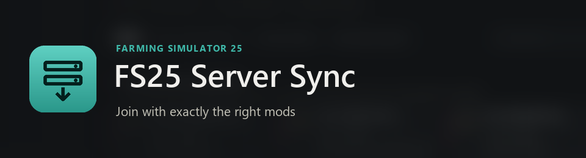
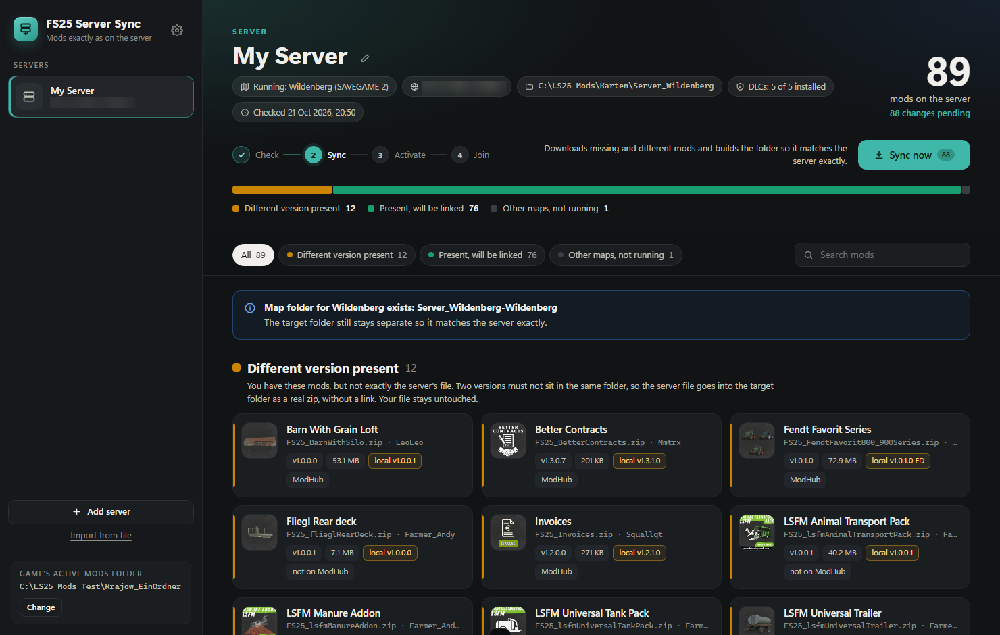
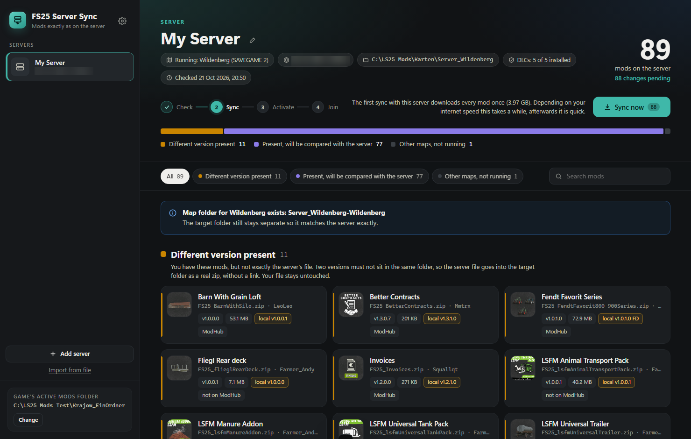

# FS25 Server Sync

**Join with exactly the right mods.**

FS25 Server Sync is a free Windows tool for Farming Simulator 25. It reads the mod list of a dedicated server, compares every mod with your own mod collection and builds a separate mods folder that matches the server exactly. Mods you already have are linked, missing or different ones are downloaded straight from the server. One click switches the game to that folder, and you can join.

The comparison uses the same hash the game uses. Two zips with the same name, version and size can still be different files for the game, for example after being packed again. Those cases are found and fixed, so the game does not refuse to let you join.

**Download:** [nalathan.itch.io/fs25-server-sync](https://nalathan.itch.io/fs25-server-sync)

Deutsche Version: [README.de.md](README.de.md)

## Features

* **Guided in four steps:** Check, Sync, Activate, Join. There is always exactly one button to press next.
* **Exact by game hash:** every mod is compared the way the game compares it. Identical files stay linked, anything else is replaced by the server's file.
* **Only one full download per server:** the first sync loads every mod once and remembers the result. Later syncs only download what changed on the server.
* **Nothing is stored twice:** files you already have are compared while downloading and never written to disk. Your own mod collection stays untouched.
* **Own folder per server:** mods are added as hardlinks, so the folder takes up no extra space. Two versions of the same mod never end up in one folder.
* **Activate with one click:** the game is switched to the server folder, the previous folder can be restored at any time. A backup of the game settings is made first.
* **Running map:** with a web interface login, the tool knows which savegame and map are running and leaves out other maps that are only enabled.
* **DLC check:** if the server uses a DLC you don't have, you are told before you try to join.
* **Web interface login:** for servers whose mods page needs a login. The password is stored encrypted for your Windows account.
* **For admins:** with mod rights, mods that are switched off on the server are listed as a cleanup suggestion. The tool never changes anything on the server.
* **Your own files are safe:** files downloaded from the server are removed once the server no longer uses them. Your own files that were in a target folder before are moved to an archive, which you can empty yourself.
* **Share a server with your friends:** export a server entry to a small file and pass it on. Your friends drag it into the window and everything is filled in. No login, no folders, no passwords are shared.
* **Settings in one place:** mod library, language, archive and how much disk space each server folder really takes up.
* **Switch the active mods folder** right from the tool: back to the game's default folder, to any server folder or to a folder of your choice.
* **Re-check single mods:** if the game still shows a red warning triangle for a mod, tick it in the list and only that mod is checked again.
* **Notices changes:** if something changes in a server folder while the tool is open, it checks again on its own.
* **Updates with one click:** when a new version is out, the tool shows it and updates itself after one click. Your servers and settings stay.
* **English, German and French,** following your Windows language or chosen in the settings.




## How to use

1. Start `FS25 Server Sync.exe`.
2. Choose your mod library, the folder that holds your mod files.
3. Click "Add server" and paste the address of the server's mods page, for example `http://123.45.67.89:8080/mods.html`. Add the web interface login if the page needs one.
4. Click "Sync now". The first sync with a server downloads every mod once, depending on your internet speed this takes a while.
5. Close the game if it is running and click "Activate folder".
6. Click "Start game" and join the server.

## Requirements

* Windows 10 or 11
* Microsoft Edge (preinstalled on Windows)
* .NET Framework 4.8 (preinstalled on Windows 10 and 11)
* The server's mods page has to be reachable, either public or with a web interface login.

No installation needed, it is a single exe.

## Build from source

Everything needed is already part of Windows, no SDK required:

```
powershell -ExecutionPolicy Bypass -File build.ps1
```

The exe is written to `dist\FS25 Server Sync.exe`.

## Good to know

* Hardlinks only work on one drive. If the server folder is on a different drive than your mod library, the mods are copied instead and take up extra space.
* Linked mods show up with their full size in Explorer, in both folders. They still take up the space only once. The settings window shows how much each server folder really uses.
* New downloads go into the subfolder `_ServerDownloads` of your mod library, archived files into `_ServerDownloads\_Archiv`.
* Mods the server offers no download for have to be added to your library by hand.
* Without the LS25 Mod Manager, the tool suggests your normal mods folder as library and stores its settings in `%LOCALAPPDATA%\FS25 Server Sync`. With the LS25 Mod Manager they are kept in the subfolder `FS25 Server Sync` next to the exe.
* As a new and unsigned program, Windows SmartScreen and a few AI based virus scanners may warn about it.

## Privacy

The tool only connects to the servers you add and, once per start, to GitHub to look for a new version. There is no account and no tracking. Its window is a small page served only to your own computer (127.0.0.1). A web interface password is encrypted with Windows (DPAPI) for your user account and sent only to that server. Note that the GIANTS web interface uses plain http, just like logging in with a browser.

## Feedback

Questions, ideas or a server where something does not work? Open an [issue](https://github.com/Nalathan01/FS25-Server-Sync/issues) or leave a comment on the [itch.io page](https://nalathan.itch.io/fs25-server-sync).

## Links

* Download: https://nalathan.itch.io/fs25-server-sync
* Website: https://www.nalathan.de/
* YouTube: https://www.youtube.com/@nalathangaming

## Code signing policy

Free code signing provided by [SignPath.io](https://about.signpath.io/), certificate by [SignPath Foundation](https://signpath.org/).

* Committers and reviewers: [Nalathan01](https://github.com/Nalathan01)
* Approvers: [Nalathan01](https://github.com/Nalathan01)

Only builds made automatically by GitHub Actions from the source code in this repository are signed.

Privacy: this program only connects to the servers you add yourself and to GitHub to look for updates. It does not send any other information to networked systems.

## License

MIT, see [LICENSE](LICENSE).

## Disclaimer

FS25 Server Sync is an unofficial fan tool. It is not affiliated with or endorsed by GIANTS Software. Farming Simulator is a trademark of GIANTS Software. All mod names and icons belong to their authors.
